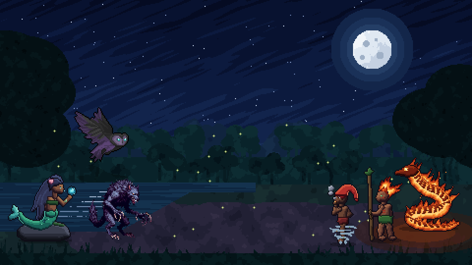

<p align="center">
  
</p>

<p align="center">
  <b>RPG de turno em 2D com as lendas do folclore brasileiro defendendo os biomas do país.</b><br>
  <a href="https://lorelore08.itch.io/espiritos-da-floresta">▶ Jogar no navegador (itch.io)</a>
</p>

<p align="center">
  
</p>

## Sobre o jogo

Os espíritos e criaturas da natureza brasileira se unem numa resistência contra a destruição da Amazônia e de outros biomas. Em cada fase a equipe enfrenta ondas de capangas e um chefe que representa um tipo de degradação ambiental. Ao vencer, uma nova lenda é resgatada e entra para o elenco.

O combate é por turnos, com visão lateral. Cada personagem tem **2 ataques** (um básico e uma habilidade especial) e só age no seu turno.

**Público-alvo:** jogadores casuais, estudantes e fãs de cultura brasileira e de jogos de estratégia leve.

## Lendas jogáveis

| Lenda | Função | Ataques | Como entra no time |
|---|---|---|---|
| Lobisomem | DPS | Garras e Mordida | Personagem inicial |
| Iara | Suporte / cura | Gotas D'Água e Cura Total | Vencer a Fase 1 |
| Matinta Pereira | Dano em área | Garras e Rajada de Vento | Vencer a Fase 2 |
| Boitatá | Queimadura | Fogo-Fátuo e Rastro de Fogo | Vencer a Fase 3 |
| Saci-Pererê | Controle | Rasteira e Redemoinho | Vencer a Fase 4 |
| Curupira | Tanque | Pegadas Invertidas e Proteção da Mata | Vencer a Fase 5 |

A equipe começa com 3 vagas e ganha uma 4ª quando o elenco chega a 4 lendas. Uma **enciclopédia** dentro do jogo conta a origem de cada lenda.

## Fases

| Fase | Bioma | Tema | Inimigos | Chefe |
|---|---|---|---|---|
| 1 | Floresta | Desmatamento | Lenhador | Chefe do Crime |
| 2 | Rio Araguaia | Pesca predatória e poluição | Pescador, Garimpeiro | Draga Poluidora |
| 3 | Cerrado | Queimadas | Incendiário, Grileiro | Trator do Correntão |
| 4 | Mata Atlântica | Caça e tráfico de animais | Caçador, Traficante | Contrabandista |
| 5 | Pantanal | Agrotóxicos | Pulverizador, Capanga | Avião Pulverizador |
| Final | Coração da Floresta | Ganância | Todos os anteriores | O Devorador |

## Controles

| Ação | Comando |
|---|---|
| Escolher ataque | Clique, ou teclas **1** e **2** |
| Escolher alvo | Clique no inimigo |
| Voltar / cancelar | Botão direito do mouse |
| Pausar | **Esc** ou **P** |

## Como abrir o projeto

1. Instale o [GameMaker](https://gamemaker.io/) (o projeto foi feito na versão 2026.0).
2. Clone o repositório ou baixe o ZIP pelo botão **Code → Download ZIP**.
3. Abra o arquivo `EspiritosDaFloresta_V4.yyp` no GameMaker e rode com **F5**.

## Estrutura

```
objects/   lógica do jogo (batalha, personagens, inimigos, menus)
scripts/   scr_batalha, scr_fases (tabela das fases), scr_ui
sprites/   arte em pixel art dos personagens, inimigos e cenários
rooms/     menu, seleção de fases, formação da equipe, fases 1 a 6, telas finais
docs/      imagens usadas neste README
```

Para criar ou ajustar uma fase, edite a tabela em [`scripts/scr_fases/scr_fases.gml`](scripts/scr_fases/scr_fases.gml).

## Equipe

Jogo desenvolvido como projeto da disciplina **Tecnologia e Desenvolvimento de Jogos Digitais**.

- Bruna Lorena
- Dominique Morem
- Luiz Henrique
- João Vitor
